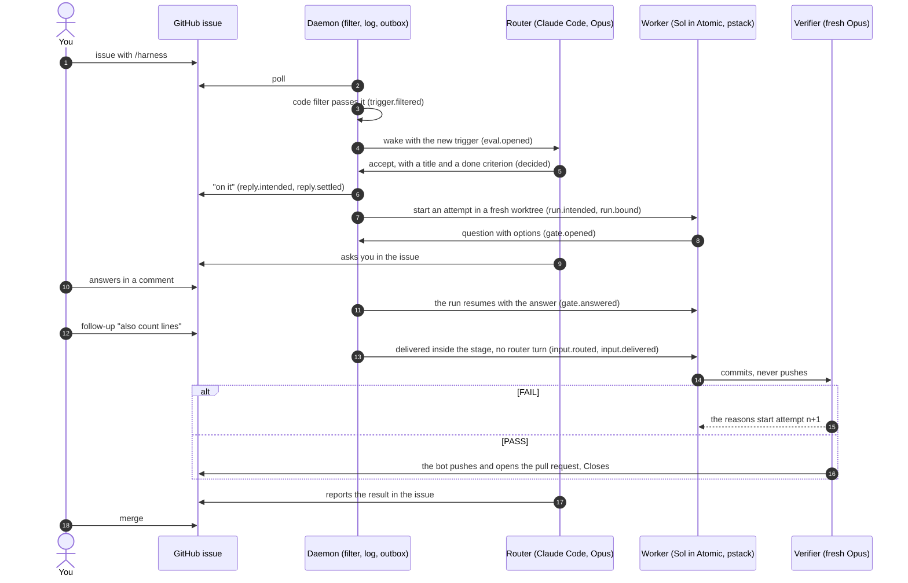
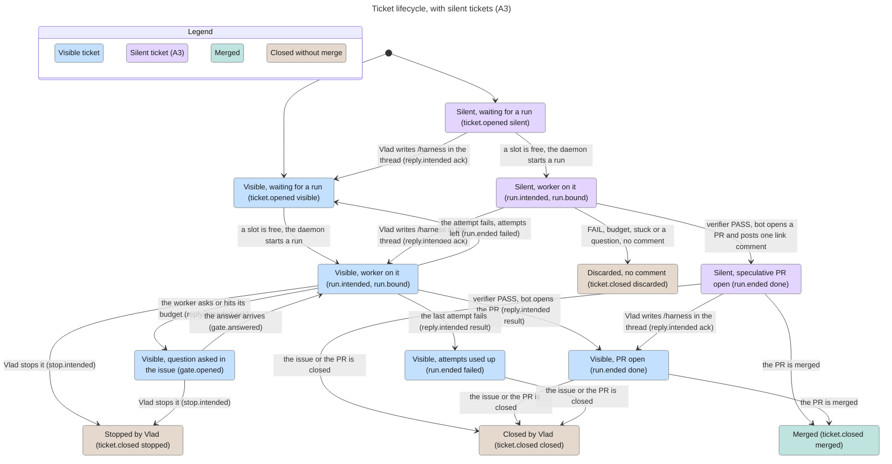
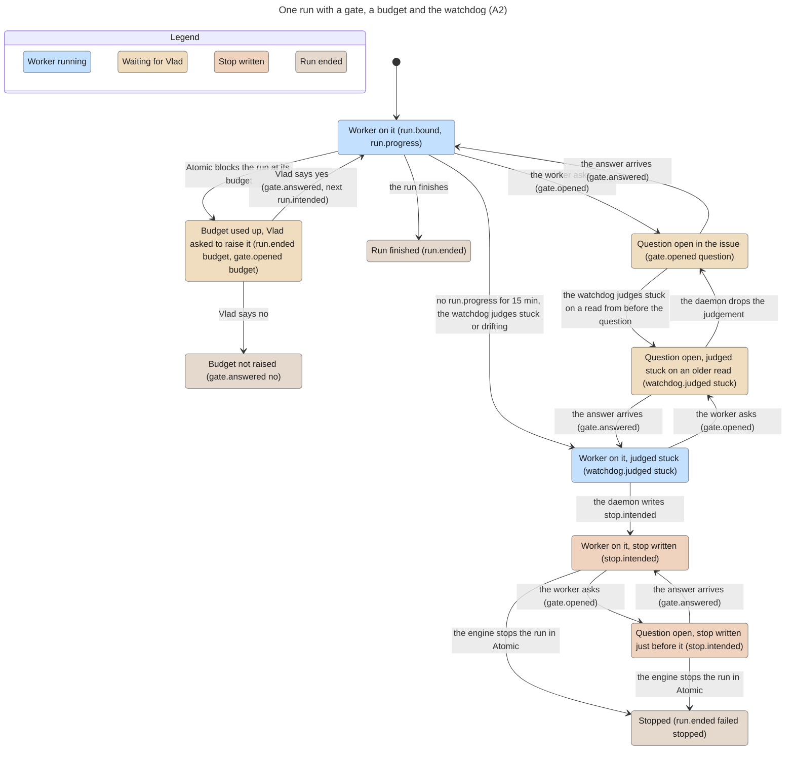
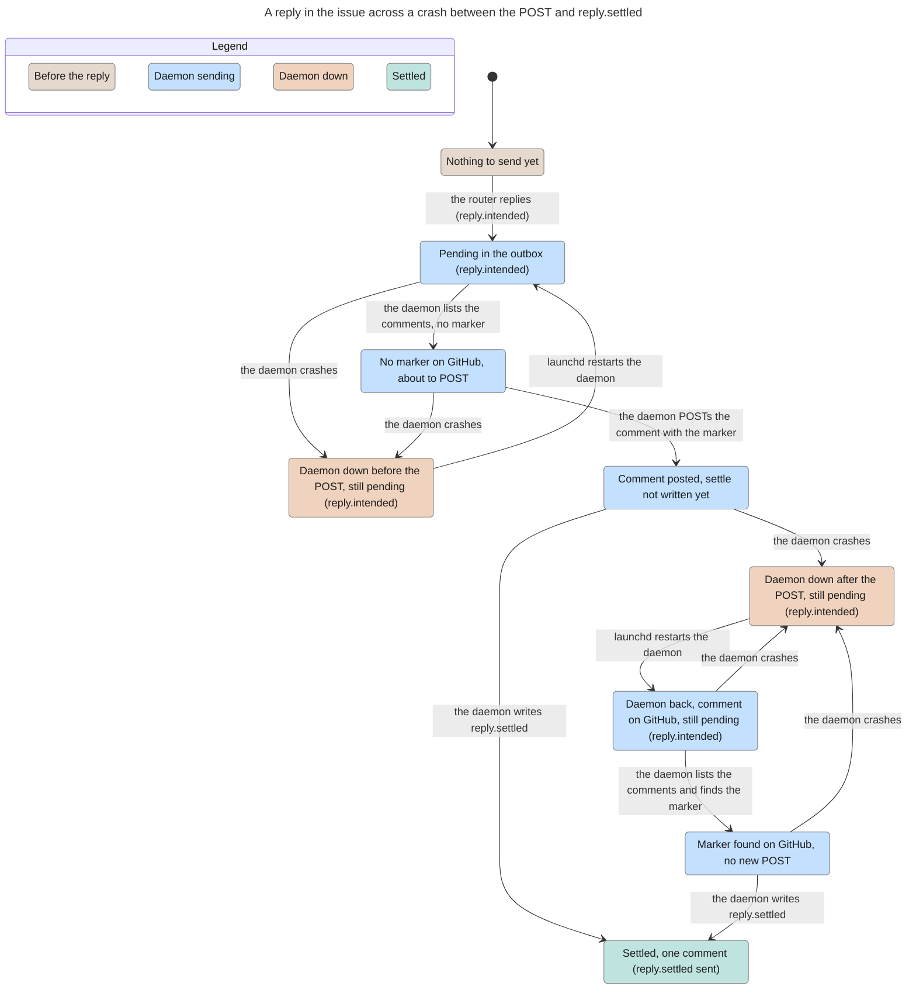
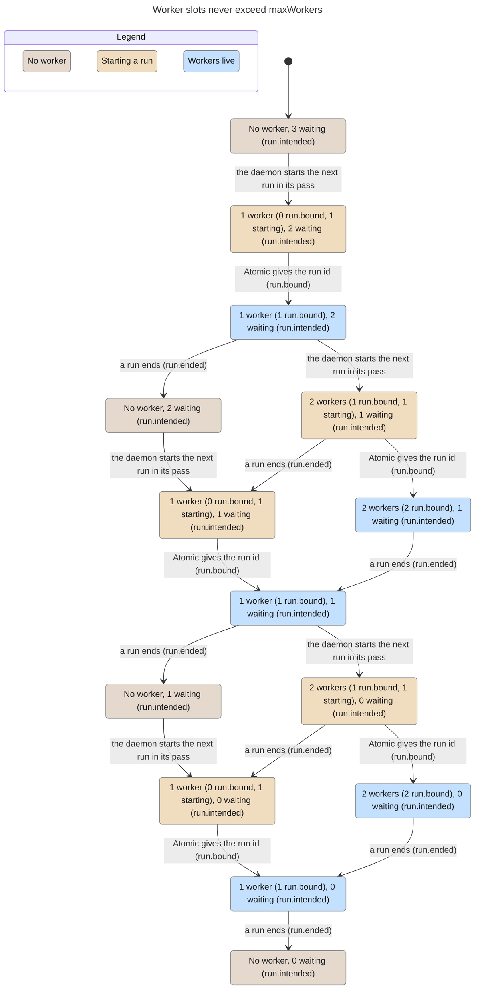

# DeepSeek Super-agent Harness

Unofficial implementation of DeepSeek's Super-agent design, built on pstack and Atomic. Not affiliated with DeepSeek.

The harness watches your GitHub repos and decides whether a request is work. A worker does the work in its own git worktree. A model from a different family checks the result, and a bot opens the pull request. You merge. The harness never merges and never deploys.

Version 0.1.0 runs on one Mac, for one person, on the repos that person lists. [Quickstart](#quickstart) · [How it works](#how-it-works) · [Compared with the article](#compared-with-the-deepseek-article) · [Limits](#limits-of-v01)



The diagram above replays a real run on the private test repo, from issue 8 to pull request 9 ([proof](design/mvp/e2e/unit7/REPORT.md)). A follow-up comment reached the worker 3 seconds after the daemon picked it up, without a router turn. Two more comments on the pull request started attempts 2 and 3 on the same pull request.

## Who it is for

The harness is for a developer who already works with coding agents and wants one agent that stays on. It listens to the repos you list, works on what you ask with `/harness`, and asks you only when it needs a decision. Your attention is the scarce resource, so everything that waits for you goes into one list, printed by `harness` with no arguments.

## How it is built



The harness joins three existing pieces in one daemon:

- **The dsh service layer**, ported to TypeScript from DeepSeek's [dsh-superagent prototype](https://github.com/deepseek-ai/dsh-superagent-prototype). It owns the GitHub source, the filter, the event log, the outbox and the attention list.
- **[Atomic](https://github.com/bastani-inc/atomic)** runs the workers. It gives each attempt durable stages, resume after a crash, a budget and questions that survive restarts. The harness accepts Atomic 0.9.x from 0.9.63 up.
- **[pstack](https://github.com/michael-denyer/pstack-claude)** is the method inside every worker, and it adds one rule: work counts as done only after a model that did not write it has verified it.

Every fact the harness learns is one row in an append-only SQLite log. An event id comes from the event's content, never from the clock, so replaying the log rebuilds the same views. A crashed daemon restarts from the same point ([proof](design/mvp/e2e/unit5/REPORT.md)).

## How it works

This is one ticket in which the worker asks a question and you add a follow-up while it works.



Four rules limit what each part can do:

- **The filter is code, not a model.** A new request passes only when an allowed person writes `/harness` as a whole word. On a thread that already has a ticket, any human comment passes as a follow-up. Bots and the harness's own comments never pass. Proof in [the build plan, unit 2](design/mvp/build-plan.md).
- **The router never runs code.** It is a Claude Code session started with `--tools ""` and five MCP tools from the harness: `next`, `decide`, `reply`, `answer` and `recall` ([`harness/src/mcp.ts`](harness/src/mcp.ts)).
- **The worker never pushes.** A guard extension blocks `git push` inside the stage (covered by tests, see [unit 4](design/mvp/e2e/unit4/REPORT.md)). The guard catches accidents and is not a security boundary. Only the publish step pushes, as the bot account.
- **The verifier only checks.** It is a new `claude -p` session with read tools and a shell for the tests. It returns PASS or FAIL with evidence. If it moves `HEAD` or leaves the tree dirty, the harness discards the verdict (covered by tests, see [unit 6](design/mvp/e2e/unit6/REPORT.md)).

### One ticket in the terminal


The GIF replays terminal output captured during the A3 proof on 2 Nov 2026 ([log](design/mvp/e2e/a3/logs/a3-trunk-vs-head.txt), [tape](docs/media/ticket.tape)). It prints the captured lines unchanged, cut at 122 characters. `harness recall` follows issue 69 to its ticket, and the ticket to pull request 78 from the bot account. The ticket was silent (row 3.4), so the issue got one comment, the link to the pull request.

### pstack inside every worker



The Atomic workflow in [`harness/atomic/harness-ticket.ts`](harness/atomic/harness-ticket.ts) has five steps. The `work` stage loads pstack's poteto-mode mandate, so the worker opens the matched playbook as a todolist and names the principles that shaped each decision. The guard log shows the mandate in 12 turns out of 12 ([proof](design/mvp/e2e/unit4/REPORT.md)). The `verify` step runs a model from another family, and its verdict is bound to the commit it checked.

## Compared with the DeepSeek article

The article is "Exploring Super-agent Design" (DeepSeek Harness, 1 Nov 2026). Each row links to the live proof on a test repo. The proof reports are in Italian.

| § | What the article asks for | Status | What the harness does | Proof |
|---|---|---|---|---|
| 1 | Continuous: always the same agent | Partial | One agent across issues, pull requests and the terminal. After a session reset the router finds old tickets with 9 recall steps. No chat channel. | [unit 10](design/mvp/e2e/unit10/REPORT.md) |
| 1 | Productive: several jobs at once, takes orders while it works | Done | Up to 3 workers in parallel with a queue, proved with 2. Comments reach the worker while it works. | [unit 10](design/mvp/e2e/unit10/REPORT.md), [unit 7](design/mvp/e2e/unit7/REPORT.md) |
| 1 | Proactive: acts on what matters, stays quiet otherwise | Done | Reacts to events without being started. On a repo where you turn it on, it also works on requests nobody addressed to it, and says nothing when that work fails (row 3.4). | [A3](design/mvp/e2e/a3/REPORT.md) |
| 1 | Persistent: always online, repairs itself | Done | launchd starts the daemon at login. After a `kill -9` a new heartbeat came 13 to 31 s later. Runs resume after a crash with the question still open. After a `kill -STOP` the watchdog restarted the frozen daemon at its second check. | [A1](design/mvp/e2e/a1/REPORT.md), [A2](design/mvp/e2e/a2/REPORT.md), [unit 5](design/mvp/e2e/unit5/REPORT.md) |
| 2 | Two levels: a router that coordinates, isolated workers | Done | The Opus router never runs code. Sol workers run in separate worktrees and never talk to you directly. | [unit 4](design/mvp/e2e/unit4/REPORT.md), [unit 6](design/mvp/e2e/unit6/REPORT.md) |
| 3.1 | Two-stage event filter: code, then model | Done | Rules in code for repos and authors, then the router's judgement. | [unit 2](design/mvp/build-plan.md) |
| 3.2 | Thread subscription: follow-ups go to the worker without the router | Done | Issues and pull requests are subscribed to their ticket. A comment reached the worker 3 s after the daemon picked it up. | [unit 7](design/mvp/e2e/unit7/REPORT.md) |
| 3.3 | Inline & Spill and Chain of Recall | Done | Long texts become a preview plus a pointer to a blob (covered by unit tests). `recall` follows event references from one event to the next. | [unit 10](design/mvp/e2e/unit10/REPORT.md) |
| 3.4 | Acting ahead: silent speculative work | Done | A silent ticket on a request nobody addressed to the harness. On PASS the bot opens one pull request and the harness posts one comment with the link. On failure GitHub shows nothing, and `harness` shows one `DISCARDED` line. Off by default, turned on per repo. | [A3](design/mvp/e2e/a3/REPORT.md) |
| 4.1 | Full duplex: answers while long work runs | Done | Runs live in the background. The router answers and asks you questions meanwhile. | [unit 5](design/mvp/e2e/unit5/REPORT.md) |
| 4.2 | Multi-channel, with a style per channel | Partial | GitHub (structured) and the terminal (at most 100 words). No chat channel. | [unit 3](design/mvp/build-plan.md) |
| 5.1 | State separated from compute | Done | Append-only SQLite log plus Atomic's journal. A dead process restarts from the same point. | [unit 5](design/mvp/e2e/unit5/REPORT.md), [engine](design/mvp/e2e/engine/REPORT.md) |
| 5.2 | Compute in the cloud, environments reached by light daemons | Out of scope | One Mac, local and personal use, by choice. | |
| 6 | Watchdog: an outside loop that judges progress | Done | A separate launchd job every 120 s. Code restarts a daemon whose heartbeat is stale. A model judges each run with no progress for 15 minutes as progressing, stuck or drifting, and the daemon stops a stuck or drifting run. It never stops a run that waits for you. | [A2](design/mvp/e2e/a2/REPORT.md) |
| Beyond | Done means verified by someone else | Done | A model of another family (Opus) verifies Sol's work before every pull request. | [unit 6](design/mvp/e2e/unit6/REPORT.md) |

A row is Done only when its proof report exists. A1, A2, A3 and A5 are the branches that closed the gaps listed in [the alignment plan](design/mvp/piano-allineamento-deepseek.md). The rows still Partial both lack a chat channel.

## Quickstart

You need macOS, Node 26.13 or later, the GitHub CLI, Claude Code logged in with a plan, and a GitHub bot account with write access to your repo. `harness setup` installs Atomic and pstack if they are missing.

Clone the repo outside `~/Desktop`, `~/Documents` and `~/Downloads`. The service runs from the clone under launchd, and during the A2 proof launchd processes started from a clone in `~/Desktop` hung in `open()` for 9 minutes. The suspected cause is the macOS privacy permission for that folder, not proved ([A2](design/mvp/e2e/a2/REPORT.md)).

```bash
mkdir -p ~/src && cd ~/src
git clone https://github.com/uppifyagency/deepseek-super-agent-harness
cd deepseek-super-agent-harness/harness
alias harness="node $PWD/src/cli.ts"
harness setup     # installs what is missing, starts the logins, stores the bot token in the Keychain, writes config.json, installs the service
harness doctor    # one line per prerequisite: ok, or manca with the command that fixes it
```


The GIF is a real `harness setup --yes` on an empty test home, with a fake token and a test Keychain entry, followed by `harness doctor` ([tape](docs/media/setup.tape), [proof](design/mvp/e2e/a5/REPORT.md)). Without `--yes`, `setup` asks only for the repo, the allowed logins and the bot token, and starts each missing login in the terminal. A second `setup` changes nothing. Both commands print their messages in Italian.

A new home starts in `observe` mode. In that mode the harness records what it would do and writes nothing on GitHub. To start working, run `harness policy auto`, or run `harness setup --mode auto` on a new home.

```bash
harness                          # what waits for you
harness policy auto --workers 2  # start working, at most 2 workers at once
harness service status           # running pid=<n> last heartbeat <s>s ago
```

Then write an issue in your repo with `/harness` and a request. Other commands: `harness ask "<text>"` talks to the router from the terminal, `harness answer <gate> <text>` answers a worker's question, and `harness recall <id>` prints the chain of events behind a ticket.

## Components

Node 26 runs the TypeScript directly, with no build step and no runtime dependencies.

| File | What it owns |
|---|---|
| [`domain.ts`](harness/src/domain.ts) | The one list of facts (`Kinds`) and the domain types. No I/O. |
| [`log.ts`](harness/src/log.ts) | The append-only SQLite log. Ids from content, views rebuilt by replay. |
| [`config.ts`](harness/src/config.ts) | `~/.harness/config.json`, or `$HARNESS_HOME`. |
| [`github.ts`](harness/src/github.ts) | The only file that talks to GitHub. Polls and sends each reply once. |
| [`service.ts`](harness/src/service.ts) | The code filter, the intake, and the `Harness` object. |
| [`routing.ts`](harness/src/routing.ts) | Router decisions, replies, the outbox and the attention list. |
| [`mcp.ts`](harness/src/mcp.ts) | The MCP server with the router's five tools. |
| [`router.ts`](harness/src/router.ts) | The router driver, `claude -p --resume`, with session rotation. |
| [`engine.ts`](harness/src/engine.ts) | The one seam with Atomic. Starts, resumes and stops runs. |
| [`workspace.ts`](harness/src/workspace.ts) | One git worktree per attempt, outside the repo. |
| [`runs.ts`](harness/src/runs.ts) | Run planning: attempts, slots, budget, follow-ups. |
| [`gates.ts`](harness/src/gates.ts) | Worker questions as gates that survive a crash. |
| [`verify.ts`](harness/src/verify.ts) | The verifier, a fresh read-only Opus session. |
| [`launchd.ts`](harness/src/launchd.ts) | The launchd plist, the run lock and the heartbeat. |
| [`watchdog.ts`](harness/src/watchdog.ts) | The outside check every 120 s: daemon health, router health, the judge of quiet runs. |
| [`setup.ts`](harness/src/setup.ts) | `harness setup` and `harness doctor`, one list of eleven steps. |
| [`cli.ts`](harness/src/cli.ts) | The `harness` command. |
| [`harness-ticket.ts`](harness/atomic/harness-ticket.ts) | The Atomic workflow for one attempt. |

## State models

Four flows have a TLA+ model checked with TLC. Each model also has a broken configuration on which TLC must fail, which proves the invariant fires. Every state names the log fact that represents it. The models, the TLC configs and an HTML view live in [`docs/statechart/`](docs/statechart/).

| Flow | Invariant | TLC on the model | TLC on the broken config |
|---|---|---|---|
| [Ticket lifecycle](docs/statechart/ticket-lifecycle/) | A silent ticket stays quiet | No error, 54 distinct states, depth 10 | Fails `SilentStaysQuiet`, 3-state trace |
| [Run with gate, budget and watchdog stop](docs/statechart/run-stop/) | No stop while a gate is open, one stop per run | No error, 143 distinct states, depth 11 | Fails `NoStopWhileGateOpen`, 5-state trace |
| [Reply across a crash](docs/statechart/issue-reply/) | At most one comment per reply | No error, 21 distinct states, depth 9 | Fails `AtMostOneComment`, 8-state trace |
| [Worker slots](docs/statechart/worker-slots/) | Never more than `maxWorkers` live runs | No error, 138 distinct states, depth 9 | Fails `WithinCap`, 5-state trace |

<details>
<summary><b>Ticket lifecycle</b>: visible, silent, promoted, discarded, stopped, merged</summary>



</details>

<details>
<summary><b>One run</b>: a question, the budget and a watchdog stop</summary>



</details>

<details>
<summary><b>A reply in the issue</b>: a crash between the POST and <code>reply.settled</code> never makes two comments</summary>



</details>

<details>
<summary><b>Worker slots</b>: never above <code>maxWorkers</code></summary>



</details>

To check the models again, run `node docs/statechart/build.mjs` with `TLA2TOOLS` pointing at `tla2tools.jar` and `STATECHART` pointing at pstack's statechart script.

## Limits of v0.1

- **One Mac.** The daemon runs under launchd as your macOS user. Compute in the cloud (article §5.2) is out of scope.
- **One repo at a time in practice.** Every proof ran on one private test repo. The config takes a list, but several real repos have not been run together.
- **One person.** The allowed list is meant for you, and the attention list is yours alone. Any human comment on a thread with a ticket reaches the worker, so keep the repos private.
- **The credential boundary is open.** The worker runs as your user, so it can read what you can read. Keep the harness on repos you own until a dedicated macOS user exists.
- **The channels are GitHub and the terminal.** There is no chat channel and no web page.
- **Atomic checks budgets between stages.** It checks cost and time only at stage boundaries, so a ticket can go past its budget inside one stage. A visible ticket stopped at $0.134 on a $0.03 budget ([unit 8](design/mvp/e2e/unit8/REPORT.md)). A silent ticket spent $0.195 on a $0.01 budget ([A3](design/mvp/e2e/a3/REPORT.md)). Budgets are in list-price dollars.
- **Issue comments come from your account.** The bot account opens the pull requests. The harness posts issue comments with the account that `gh` is logged in to on the Mac, which is usually yours ([log](design/mvp/e2e/a3/logs/a3-trunk-vs-head.txt)).
- **Time awake after a cold boot is not observed.** The watchdog counts quiet time only while the Mac is awake, from `kern.waketime`. Nobody restarted the Mac during the proofs, so the value after a cold boot comes from the xnu source, not from a run ([A2](design/mvp/e2e/a2/REPORT.md)).
- **Atomic 0.9.x from 0.9.63 up.** The proofs ran on 0.9.63 and 0.9.64, the version on the development Mac. `doctor` flags 0.10 or later and leaves it installed ([A5](design/mvp/e2e/a5/REPORT.md)).
- **`doctor` can report `gh` as not logged in when it is.** `doctor` stops each check after 2.5 s. When the macOS keyring lookup behind `gh auth status` is slow, the check runs out of time and `doctor` prints `manca  gh autenticato`. Run `doctor` again before you log in again. Twelve timed runs on 03/11 all finished in under 1 s ([misura.txt](design/mvp/e2e/gh-auth/misura.txt), from [misura.zsh](design/mvp/e2e/gh-auth/misura.zsh)), so the slow lookup is occasional.
- **A comment written while the daemon is down still counts after a restart.** The daemon reads it on restart as a new message, even if the issue was closed in the meantime. On the test repo, the closing comment of issue #127 started a second attempt ([log](design/mvp/e2e/int/logs/int-stuck.txt)).

A small ticket from issue to pull request used about $0.40 at list price for the worker, the verifier and the router (measured, [unit 6](design/mvp/e2e/unit6/REPORT.md)). On a subscription plan that is usage quota, not spend.

## Roadmap to v0.2

v0.2 moves the harness to a company Mac mini and adds four things:

- A dedicated macOS user for the harness. It closes the credential boundary and sets the commit author.
- Several allowed people.
- Business plans for the models.
- A team channel next to GitHub and the terminal.

## Verify it yourself

```bash
cd harness && npm ci && npm test && npm run typecheck
node tools/check-publish.mjs    # no tokens, home or session paths, emails, terms in .git/info/private-terms, or files over 1 MB
node tools/check-readme.mjs     # every link resolves, every image has alt text, media stay small
node tools/check-readme.mjs --release   # also fails while a pending marker is left, run before publishing
docs/media/record.sh            # records the two GIFs again from a checkout under /tmp, with a test home
```

`.git/info/private-terms` stays outside the repository. Each line is a term that `check-publish.mjs` rejects in any case, or `text => replacement`, which `tools/scrub-paths.mjs` also rewrites. Lines that start with `#` are ignored.

The live proofs are in [`design/mvp/e2e/`](design/mvp/e2e/), one `REPORT.md` per unit, with the logs next to it. The design is in [`design/mvp/rationale.md`](design/mvp/rationale.md), and the Italian project index is [`docs/indice.md`](docs/indice.md).

## Credits

- **DeepSeek**, for the article "Exploring Super-agent Design" ([original post](https://x.com/DeepSeekHarness/status/2116857257245987236)), which describes the design this harness follows.
- **[dsh-superagent-prototype](https://github.com/deepseek-ai/dsh-superagent-prototype)** (MIT, Copyright (c) 2026 DeepSeek Harness Team). The service layer is ported from it.
- **[Atomic](https://github.com/bastani-inc/atomic)**, the engine that runs the workers. The harness loads it from the global install and does not ship it.
- **[pstack](https://github.com/michael-denyer/pstack-claude)**, the Claude Code port of the Cursor pstack plugin, the method inside every worker.

## License

MIT License, Copyright (c) 2026 Vlad Vrinceanu. See [LICENSE](LICENSE). [NOTICE](NOTICE) credits the ported code and names the runtime dependencies that the repo does not ship.

This project is not affiliated with, endorsed by or sponsored by DeepSeek.
